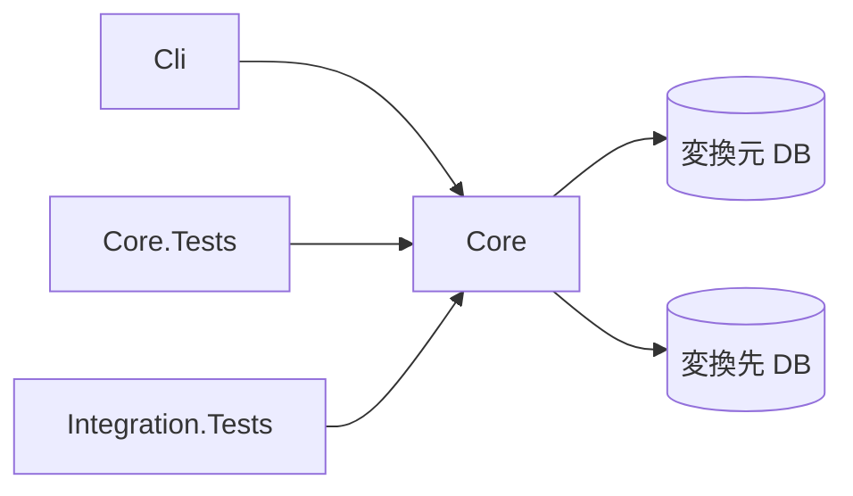

# アーキテクチャ方針

## 位置づけ

Pleasanter の DB を、SQL Server・PostgreSQL・MySQL の間で相互に変換するコマンドラインツールです。
Pleasanter 本体のコードは取り込みません。派生著作物にしないことで、ライセンスの選択肢（[ライセンス](ライセンス.md)）を残します。
表と列の定義は持ちません。**変換先と変換元の実際の列（情報スキーマ）を読み、同名の列を突き合わせて**コピーします。
本体のソース（`_reference/Implem.Pleasanter`）は、挙動の**事実確認のためにだけ読み**ました（下の「事実確認」）。

## 既存の機能と、このツールの範囲

根拠は `_reference/Implem.Pleasanter`（固定位置 `Pleasanter_1.5.8.1`）の `Implem.CodeDefiner/Starter.cs`。参照日 2026-10-20。

- CodeDefiner の `migrate` は、**移行元（`Migration.json` の `Dbms`）が SQL Server のみ**、**移行先（`Rds.json` の `Dbms`）が PostgreSQL または MySQL のみ**
  （`CanMigrate`）。つまり対応しているのは「SQL Server → PostgreSQL」「SQL Server → MySQL」だけ
- このツールは、**3 つの DBMS のあらゆる向き**（6 通り）を扱う

| 変換元 \ 変換先 | SQL Server | PostgreSQL | MySQL |
| --- | --- | --- | --- |
| SQL Server | — | CodeDefiner にもある | CodeDefiner にもある |
| PostgreSQL | **新規** | — | **新規** |
| MySQL | **新規** | **新規** | — |

## 構成

- `Core`: 変換の本体
  - `Schema`: 表・列・型の表現と、情報スキーマの型名の正規化（`TypeCatalog`）
  - `Planning`: 変換元と変換先の突き合わせ（`ConversionPlanner`）。同名の表・列、足りない列・余る列、親 → 子の順序
  - `Values`: 値の変換（`ValueConverter`）と、内容の整合の要約（`TableDigest`）
  - `Engine`: 変換の本体（`ConversionEngine`）。`ISourceDatabase` / `ITargetDatabase` にだけ依存する
  - `Databases`: DBMS ごとの方言（`IDatabaseDialect` を `SqlServerDialect` / `PostgreSqlDialect` / `MySqlDialect` が実装）と、ADO.NET との組み合わせ（`AdoDatabase`）
  - `CommandLine`: 引数の解析と、コマンドの本体（`ConverterApplication`。入出力・環境変数・DB 接続を差し替えられる）
- `Cli`: `Program.cs` だけ。実際の入出力・環境変数・DB 接続・Ctrl+C を `ConverterApplication` へ結びつける（コンソールへ出す文字列は英語）
- `Core.Tests`: 単体テスト（DB なし。偽の source / target をメモリ上に用意する）
- `Integration.Tests`: 実機の DB へのテスト。環境変数が無ければスキップ（CI は `DBCONV_REQUIRE_ALL_RDBMS=1` で、未設定なら落とす）

DB への SQL は、値をすべてパラメータで渡し、識別子は情報スキーマから得たものだけを、DBMS ごとの引用符（`[ ]` / `" "` / `` ` ``）でエスケープして使います。

## 事実確認

出典は `_reference/Implem.Pleasanter`（`Pleasanter_1.5.8.1`）。参照日 2026-10-20。

### CodeDefiner の `migrate`（`Implem.CodeDefiner/Functions/AspNetMvc/CSharp/Migrator.cs`）の挙動

- 対象の表: 列定義（`Def.ColumnDefinitionCollection`）から、`_` で始まる表、`NotUpdate` の列、結合列・計算列を除き、
  `Migration.json` の `ExcludeTables` と Quartz の表（`Tables.IsQuartzTable`）を除いた表。**表ごとに、本体 → `_deleted` → `_history` の順**
- 列の扱い: 変換元へ `select * from "表"`（`MigrateDatabaseSelectFrom`。SQL Server のみ実装）を発行し、**読めた列をそのまま同名の列へ**入れる。型の変換はしない（ドライバの値をパラメータで渡すだけ）
- 書き込み: **1 行ずつ** INSERT（`Def.Sql.MigrateDatabaseInsert`）。MySQL は `sql_mode = ansi_quotes,pipes_as_concat,strict_all_tables` を付ける
- 失敗: 行ごとの例外を `*_Migrate.log` へ書き（長い値は 1024 文字で切る）、数えて続ける。`AbortWhenException` なら止める
- 採番: **PostgreSQL だけ** `setval(pg_get_serial_sequence(...), max(列))` を、本体の表の最初の IDENTITY 列へ実行する（`MigrateDatabaseSelectSetval`）。
  `_deleted`・`_history` には採番が無い。MySQL は空（`AUTO_INCREMENT` は明示値の挿入で自動的に進む）
- 外部キー・トリガ: 触れない。そもそも本体の定義に無い（下記）
- 件数・内容の確認: しない

### 本体の表の採番（自動採番列）

`Implem.Pleasanter/App_Data/Definitions/Definition_Column` で `"Identity": "1"` の列は次の 17 本（いずれも本体の表。`_deleted`・`_history` には付かない:
`Implem.CodeDefiner/Functions/Rds/Parts/Columns.cs` の `noIdentity`、`MySqlConstraints.cs` の `NeedsAutoIncrement`）。

`BackgroundJobs.BackgroundJobId`、`Binaries.BinaryId`、`Demos.DemoId`、`Depts.DeptId`、`Extensions.ExtensionId`、`Groups.GroupId`、`Items.ReferenceId`、
`MailAddresses.MailAddressId`、`McpLogs.McpLogId`、`OutgoingMails.OutgoingMailId`、`Parameters.ParameterId`、`Passkeys.PasskeyId`、
`Registrations.RegistrationId`、`ScimTokens.ScimTokenId`、`SysLogs.SysLogId`、`Tenants.TenantId`、`Users.UserId`

DBMS ごとの作り方: SQL Server は `identity(開始値, 1)`、PostgreSQL は `generated by default as identity (start with 開始値 increment by 1)`、
MySQL は `auto_increment`（開始値は `alter table ... auto_increment = 開始値`）。
`Sites` / `Issues` / `Results` / `Wikis` の `SiteId` などは `Items.ReferenceId` から払い出された値で、採番列ではない。
**このツールは表名を決め打ちにせず、情報スキーマから採番列を検出する**（上の一覧は事実確認の記録で、コードには持たない）。

### 型の対応（CodeDefiner が各 DBMS で作る型）

`Rds/Implem.*/*DataTypes.cs`、`Parts/MySql/MySqlColumns.cs` より。

| 本体の定義 | SQL Server | PostgreSQL | MySQL |
| --- | --- | --- | --- |
| `nvarchar(n)` | `nvarchar(n)` | `varchar(n)` | `varchar(n)`（n ≥ 1024 は `text`。索引か既定値のある列は `varchar(760)`） |
| `nvarchar(max)` | `nvarchar(max)` | `text` | `longtext` |
| `nchar(n)` | `nchar(n)` | `char(n)` | `char(n)` |
| `bit` | `bit` | `boolean` | `tinyint(1)` |
| `datetime` | `datetime` | `timestamp(3)` | `datetime(3)` |
| `varbinary(max)` | `varbinary(max)` | `bytea` | `blob`（64KB） |
| `image`（`Binaries.Bin` など） | `image` | `bytea` | `longblob` |
| `float` | `float` | `float`（= 倍精度） | `float`（**単精度**） |
| `decimal(p,s)` | `decimal(p,s)` | `numeric(p,s)` | `decimal(p,s)` |

### 外部キー・トリガ・索引

`Implem.CodeDefiner` と `Definitions/Sqls` に、外部キー（`foreign key` / `references`）とトリガ（`create trigger`）の定義は**無い**（主キー・索引・既定値だけ）。
したがって Pleasanter の表では、コピーの順序は結果に影響しない。それでも、他のスキーマ（拡張の表など）に備えて次のとおりにする。

- **順序**: 変換先の外部キー（情報スキーマ／カタログ）から親 → 子の順に並べる（同順位は表名順）
- **循環・自己参照**: 既定ではその表を失敗にする。`--disable-constraints` で続行できる
- **一時的な無効化**（`--disable-constraints`）: SQL Server は表ごとの `NOCHECK CONSTRAINT ALL` と、終了時の `WITH CHECK CHECK CONSTRAINT ALL`（違反が見つかれば失敗にする）。
  PostgreSQL は `session_replication_role = replica`（スーパーユーザー権限が要る。外部キーとトリガが働かなくなり、あとで検査しない）。
  MySQL は `FOREIGN_KEY_CHECKS = 0`（あとで検査しない）。権限が無く無効にできないときは、警告して親 → 子の順序だけで続ける
- **索引**: コピーしない（CodeDefiner が作る）

### 接続の注意（実機で分かった事実）

- PostgreSQL では、Pleasanter の表は**サービス名のスキーマ**（例: `Implem.Pleasanter`）にある。
  本体の接続文字列は `Search Path` をサービス名にしている（`Implem.DefinitionAccessor/Def.cs`）。
  このツールは**現在のスキーマ**（`current_schema()`）の表を読むので、接続文字列に `Search Path` が要る。
  サービス名に `.` を含むときは、引用符つきで `Search Path='"Implem.Pleasanter"'` と書く（引用符なしでは現在のスキーマにならないことを確かめた）。
  表が 1 つも見つからないときは、このことを案内して失敗にする
- SQL Server は接続ユーザーの既定のスキーマ（`SCHEMA_NAME()`、通常 `dbo`）、MySQL は接続先のデータベースを対象にする

## 型の変換表（変換先の列の型を見て値を変換する）

実装は `Schema/TypeCatalog.cs`（DBMS の型 → 値の種類）と `Values/ValueConverter.cs`（値の変換）。
**変換先に入らない値は、表・行・列を示して失敗として数える（黙って丸めない）。** 失敗した行だけをとばして続ける。

| 値の種類 | 変換元の型 | 変換先の型への規則 |
| --- | --- | --- |
| 真偽 | `bit` / `boolean` / `tinyint(1)` | 真偽 ↔ 真偽。整数へは 0 / 1。整数からは 0 / 1 だけ（他は失敗） |
| 整数 | `tinyint`（SQL Server は 0〜255、MySQL は符号付き）、`smallint`、`int`、`bigint`、MySQL の `mediumint` と `unsigned`（`bigint unsigned` は扱わない） | 変換先の範囲で検査。範囲外は失敗。小数部のある値は失敗 |
| 小数 | `decimal` / `numeric` / `money` | 末尾の 0 を落として、整数部の桁数（p − s）と小数部の桁数（s）を検査。収まらなければ失敗 |
| 浮動小数点 | `float` / `real` / `double` | 単精度の列（SQL Server の `real`、PostgreSQL の `real`、MySQL の `float`）へは丸めて**丸めた数を数える**。NaN・無限大は PostgreSQL だけが受け取る |
| 文字列 | `nvarchar` / `varchar` / `char` / `text` / `longtext` | 長さを**変換先の数え方**で検査（SQL Server は UTF-16 の単位、PostgreSQL・MySQL の `varchar` はコードポイント、MySQL の `text` 系は UTF-8 のバイト数）。NUL（U+0000）は PostgreSQL へ入れられないので失敗。対にならないサロゲートは SQL Server 以外で失敗。サロゲートペア（絵文字）は通る。固定長（`char`）は末尾の空白を区別しない（読み戻しの比較で無視する） |
| バイナリ | `varbinary` / `image` / `bytea` / `blob` / `longblob` | 長さを検査（MySQL の `blob` は 64KB。超えたら失敗） |
| 日時 | `datetime`（SQL Server）/ `datetime2` / `timestamp`（PostgreSQL）/ `datetime`（MySQL） | **時間帯は付けない**（`Kind` は常に Unspecified）。SQL Server の `datetime` は 1753-01-01〜9999-12-31 23:59:59.997 で 1/300 秒刻み（範囲外は失敗、刻みへの丸めは丸めた数を数える）。MySQL は 1000-01-01 以降（それより前は失敗）。小数秒は変換先の桁へ丸めて、丸めた数を数える。`0001-01-01` は PostgreSQL と SQL Server の `datetime2` では保てる。SQL Server の `datetime` と MySQL へは入らないので失敗 |
| GUID | `uniqueidentifier` / `uuid`（MySQL は `char(36)`） | GUID ↔ GUID。文字列へは小文字・ハイフンつきの 36 文字。文字列からは解析（不正は失敗） |
| 行バージョン | SQL Server の `timestamp` / `rowversion`、計算列、生成列 | **変換先へ入れない**（警告） |
| その他 | `date` / `time` / 時間帯つき / `xml` / `json` など | 扱わない。その列がある表は、変換前に失敗にして何も書かない |

型の組み合わせが対応しない（例: バイナリ → 日時）列は、その表を変換前に失敗にして、何も書かない。
変換先の長さ・範囲が変換元より狭いときは、計画の時点で警告する（行ごとの検査で収まらない値だけが失敗になる）。
NULL は、変換先が NULL を許す列にだけ入れる（NOT NULL の列へは、その行を失敗にする）。

### 照合順序

大文字小文字・濁点・アクセントの違いで変換先の一意制約が破れる行は、バッチの書き込みが失敗したあと**1 行ずつ書き直して**特定し、主キーを示して失敗として数える。
実機で確かめた例: PostgreSQL（区別する）→ SQL Server（既定は大文字小文字を区別しない）では `abc` と `ABC`、
→ MySQL（`utf8mb4_general_ci`）では `abc` と `ABC`、`cafe` と `café` が衝突する。

## 決めたこと

- **変換元は読み取りだけ。** SELECT しか発行しない。PostgreSQL と MySQL は、セッションも読み取り専用にする（`default_transaction_read_only`、`SET SESSION TRANSACTION READ ONLY`）。
  SQL Server には同等のセッションが無いので、読み取り専用の権限（`db_datareader`）の利用者を勧める
- **変換先は、Pleasanter 本体（CodeDefiner）が作った空の DB を前提にする。** 表の定義はこのツールが作らず、本体に作らせる。
  理由: 表・列・索引の定義は本体のバージョンごとに変わり、ここで再実装すると必ずずれるため。
  **このツールが作る表は、完了の記録用の管理表 `__DatabaseConverterProgress` だけ**（Pleasanter の表と衝突しない名前）
- **表・列の突き合わせ**（`ConversionPlanner`）:
  - 同名（完全一致 → 大文字小文字を無視して一意なもの）の表・列を対応づける
  - 変換先にあって変換元に無い列: NULL 可・既定値あり・採番列なら警告（DB の既定値か NULL）。**NOT NULL で既定値が無ければ、その表を失敗にする**
  - 変換元にあって変換先に無い列: 無視して警告
  - 変換元だけにある表: **行があれば失敗**（コピーされないデータがあるため）、空なら警告だけ
  - 変換先だけにある表: 何もしない（一覧には出す）
  - Quartz の表（`QRTZ_` で始まる）: 既定でコピーしない（CodeDefiner の `migrate` も除外している）。`--tables` で名指しすればコピーする
- **事前確認で 1 つでも問題があれば、何も書かずに止める**（表の定義の不一致、変換先が空でない、など）。直すか `--exclude-tables` で外してやり直す
- **バッチ**: 既定 1000 行。変換元は 1 本の読み取りを流し（`SequentialAccess`、主キー順）、変換先へはバッチごとに書く。
  バッチは概算のバイト数（既定 4MiB。`--max-batch-bytes`）でも区切るので、`Binaries.Bin` のような大きな列の表では行数が減る。
  書き込みは、パラメータ化した複数行 `INSERT`（1 文のパラメータ数の上限に収める）を、バッチごとの 1 つのトランザクションで行う。
  選んだ理由: 3 つのドライバの高速な書き込み（`SqlBulkCopy`・Npgsql の binary COPY・`MySqlBulkCopy`）より遅いが、
  列の型に合わせたパラメータで型の扱いが素直で、失敗した行を 1 行ずつの再実行で特定できる（動作の確実さを優先）
- **失敗した行の特定**: バッチが失敗したら取り消し、その行たちを 1 行ずつ書き直して、入らない行（一意制約の違反、DB が拒否した値）を主キーつきで失敗として数える
- **自動採番**（`AdoDatabase` / 各方言）: 情報スキーマから採番列を検出し、変換先の「次の番号」を
  `max(変換元の次の番号, 変換先の最大値 + 1)` に合わせる。変換元の次の番号は、SQL Server は `sys.identity_columns`、PostgreSQL は sequence（`last_value` / `is_called`）、
  MySQL は `information_schema.TABLES.AUTO_INCREMENT`（8.0 は 24 時間キャッシュするのでセッションで `information_schema_stats_expiry = 0` にする）から読む。
  変換先へは SQL Server が `SET IDENTITY_INSERT ON`（表ごと）と `DBCC CHECKIDENT ... RESEED`、PostgreSQL が `setval(sequence, 次の番号, false)`（`GENERATED ALWAYS` の列には `OVERRIDING SYSTEM VALUE`）、MySQL が `ALTER TABLE ... AUTO_INCREMENT`。
  **変換元の次の番号を使う理由**: 末尾の行が消えている表（`Items_deleted` や履歴が同じ番号を持つ）で、番号を再利用しないため。CodeDefiner の `migrate` は最大値だけを見る
- **変換先の MySQL のセッション**: `sql_mode = STRICT_ALL_TABLES,NO_AUTO_VALUE_ON_ZERO,NO_ZERO_DATE,NO_ZERO_IN_DATE`（範囲外や長すぎる値を黙って丸めない。0 を自動採番として扱わない）。
  接続は `GuidFormat=None`（`char(36)` を文字列として読む）、`utf8mb4`
- **変換のあとに、表ごとの件数と内容の整合を確かめる**（`TableDigest`）: 書いた値（変換後）と、変換先から読み戻した値を、変換先の型で正規化して、
  件数・主キーの集合・列ごとのチェックサム・行ごとのチェックサム（順序に依存しない合計）を突き合わせる。違う列は列名で示す。確かめられなければ失敗として数える
- **途中で止めても、やり直せる**（再開の方式）:
  - 変換先の DB に管理表 `__DatabaseConverterProgress`（`TableName`, `CopiedRows`, `CompletedAt`, `ToolVersion`）を作り、**表ごとに、コピーと整合の確認がすべて成功したときだけ**完了を記録する（失敗のある表は記録しない）
  - **既定では、変換先の表が空でなければ、何も書かずに止める**（安全側）
  - `--resume`: 完了を記録した表はとばす（件数だけ確かめ、違えば失敗）。記録の無い表で、変換先に行が残っていれば（途中で止まった）**行を全部消して最初から入れ直す**
  - 全表が成功したあとに管理表を消すなら `--cleanup-progress`（既定は残す）
  - ドライランは管理表を作らない（あれば読むだけ）
  - 実行中に Ctrl+C を押すと、実行中のバッチを終えて止める。途中の表は完了を記録しないので、`--resume` で入れ直せる
- **ドライラン**（`--dry-run`）: 何を何行・何列移すか、警告、定義の不一致を出す。何も書かない（接続の設定以外）。問題があれば終了コード 1
- **接続**: DBMS と接続文字列を引数・環境変数で受ける。**接続文字列を引数に直接書くオプションは無い**（環境変数・ファイル・標準入力のどれか）。
  接続文字列・パスワードはログへ出さない（解決した時点で登録して、出力から伏せる。接続文字列の不正のメッセージにも断片を入れない）
- **終了コード**: 全件成功 0、失敗があれば 1（中断を含む）、引数エラー 2。同じ DBMS 同士は引数エラー
- **依存は寛容ライセンスに限る。** デュアルライセンスを選べる状態を保つため。**例外が 1 つある**（次の「依存」）

## 依存

DB ドライバ（いずれも `Core` が参照する）: `Microsoft.Data.SqlClient` 7.1.1（MIT）、`Npgsql` 10.0.3（PostgreSQL License）、`MySqlConnector` 2.6.2（MIT）。
推移的依存は MIT。詳細は [NOTICE](../NOTICE) と各 `packages.lock.json`。
`System.Security.Cryptography.Pkcs` は、SqlClient が引く 9.0.18 に既知の脆弱性（GHSA-2fmv-rv2c-59x7 / GHSA-846f-f764-76mx）があるため、10.0.13 へ固定している。

**寛容ライセンスの例外（利用者の決定 2026-10-20）**: `Microsoft.Data.SqlClient` が Windows 向けに推移的に引く `Microsoft.Data.SqlClient.SNI.runtime` 7.1.0 は、MIT ではなく
**Microsoft Software License Terms**（独自の許諾）。再頒布の条件（アプリの一部としてのみ頒布する、頒布先に同程度の条件へ同意させる、Microsoft への補償）を [NOTICE](../NOTICE) に明記したうえで許容する。
法務の確認は別途。頒布するときは、その条件を利用許諾へ反映する。

## 実機での確認

- GitHub Actions のサービスコンテナ（SQL Server 2025 / PostgreSQL 18 / MySQL 26）で、Pleasanter の表を模した小さな表の 6 通りの変換を行う（`.github/workflows/integration.yml`）
- 実装時に、手元の Docker で同じ 3 つのイメージを起動し、(1) 上の結合テスト（14 件）と、(2) 本物の CodeDefiner（`implem/pleasanter:codedefiner`）が作った
  Pleasanter の表（99 表）で SQL Server → PostgreSQL → MySQL → SQL Server と変換（少数の行を入れた `Items` / `Binaries` / `Users` を含む。件数と整合が一致し、`Items` の採番は変換元どおり 6 から続くことを確認）した。
  Pleasanter 本体のアプリの動作（変換後の DB で Pleasanter が起動してデータを読めること）は確かめていない

## 未決定

- **変換後の DB で Pleasanter 本体が起動して動くことの確認**: このツールの範囲は DB の内容の一致まで。本体を変換後の DB に向けた確認は、実データでの運用前に必要
- **MySQL の `0000-00-00`（ゼロ日付）**: 読み取りでドライバが例外にするため、その表は読み取りの失敗になる。ゼロ日付を `NULL` などへ読み替えるかは、実データを見て決める
- **大量データの性能**: 複数行 `INSERT` は、ドライバの高速な書き込みより遅い。実データの規模（数千万行の `Items` など）で遅すぎる場合は、PostgreSQL の binary COPY などへ切り替える（`IDatabaseDialect` の実装の差し替えで済む）。未計測
- **照合順序の違いの事前検知**: 現在は書き込み時の一意制約違反として特定する（事前に変換先の照合順序を読んで警告はしない）
- **`timestamp with time zone` / `date` / `time` / `json` など Pleasanter の標準の表に無い型**: 扱わない（その列を含む表は失敗にする）
- **SQL Server の変換元を読み取り専用にする強制**: セッションに同等の仕組みが無い。権限での制限を勧めるに留める
