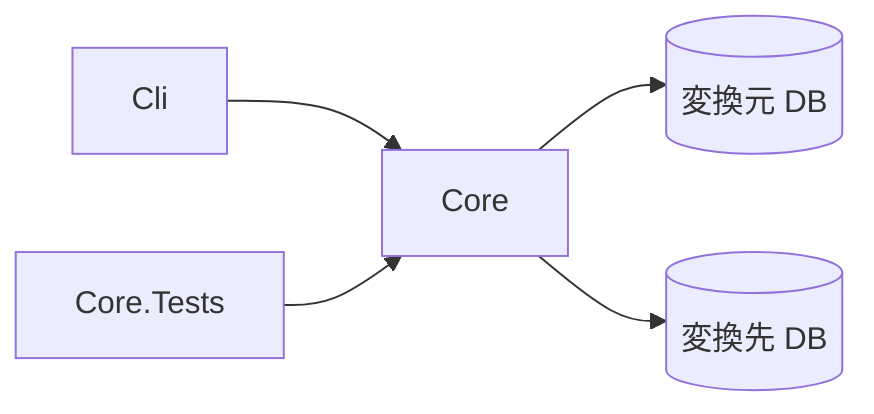

# アーキテクチャ方針

## 位置づけ

Pleasanter の DB を、SQL Server・PostgreSQL・MySQL の間で相互に変換するコマンドラインツールです。
Pleasanter 本体のコードは取り込みません。派生著作物にしないことで、ライセンスの選択肢（[ライセンス](ライセンス.md)）を残します。
表と列の定義は、`_reference/Implem.Pleasanter` のソースを**事実確認のために読んだ**うえで、このツールが独自に実装します。

## 既存の機能と、このツールの範囲

根拠は `_reference/Implem.Pleasanter`（固定位置 `Pleasanter_1.5.8.1`）の `Implem.CodeDefiner/Starter.cs`。参照日 2026-10-20。

- CodeDefiner の `migrate` は、**移行元（`Migration.json` の `Dbms`）が SQL Server のみ**、**移行先（`Rds.json` の `Dbms`）が PostgreSQL または MySQL のみ**
  （`CanMigrate`）。つまり対応しているのは「SQL Server → PostgreSQL」「SQL Server → MySQL」だけ
- このツールは、**3 つの DBMS のあらゆる向き**（6 通り）を扱う

| 変換元 \ 変換先 | SQL Server | PostgreSQL | MySQL |
| --- | --- | --- | --- |
| SQL Server | — | CodeDefiner にもある | CodeDefiner にもある |
| PostgreSQL | **新規** | — | **新規** |
| MySQL | **新規** | **新規** | — |

## 構成

- `Core`: 変換の本体。DBMS ごとの読み書き（方言）、表と列の対応、型の変換、整合の確認
- `Cli`: コマンドライン。接続先と変換の向きを受け取り、進み具合を英語で出す（コンソールへ出す文字列は英語）
- `Core.Tests`: 単体テスト。型の変換と SQL の組み立ては DB なしで、実機の DB を使うものは別に分ける

## 決めたこと

- **変換元は読み取りだけ。** 書き換えない
- **変換先は、Pleasanter 本体（CodeDefiner）が作った空の DB を前提にする。** 表の定義はこのツールが作らず、本体に作らせる。
  理由: 表・列・索引の定義は本体のバージョンごとに変わり、ここで再実装すると必ずずれるため
- **変換のあとに、表ごとの件数と、内容の整合（キーの集合・サンプルの比較）を確かめる**
- **途中で止めても、やり直せる。** 表ごとに完了を記録する
- **ドライラン**（何をどれだけ移すかだけ出す）を持つ
- **依存は寛容ライセンスに限る。** デュアルライセンスを選べる状態を保つため

## 未決定

- 変換先を「本体が作った空の DB」とする前提で足りるか。足りない場合（本体が使えない環境）に、表の作成まで受け持つか
- 型の対応の細部: 日時（時間帯・精度）、真偽値、`NVARCHAR(MAX)`／`text`、行バージョン、IDENTITY／sequence／AUTO_INCREMENT の続き番号
- 照合順序（大文字小文字・濁点）の違いで、一意制約が破れる場合の扱い
- 巨大な表（`Items`・`Results`・`Binaries` など）の分割と、メモリの上限
- 実機の SQL Server・PostgreSQL・MySQL に対する動作確認は行っていない
